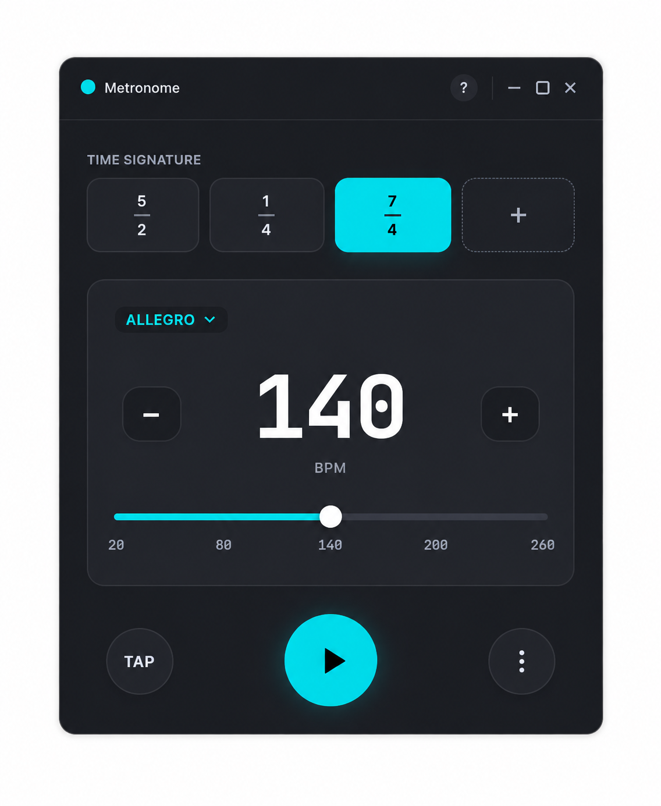

# Metronome

A dark GTK metronome for practice. Set a tempo, choose a time signature, and play.

This is a modified version of [GNOME Metronome](https://gitlab.gnome.org/World/metronome) by Adrien Plazas and contributors. The interface was redesigned in 2026. The license is unchanged: GPL-3.0-or-later.

<p align="center">
  
</p>

## Features

- Tempo from 20 to 260 BPM, with a slider and step buttons
- Tempo markings from Largo to Prestissimo
- Tap to estimate the tempo
- Custom time signatures, kept between sessions
- An accent on any beat
- Play and pause, plus keyboard shortcuts

## Building

From Flathub, `flatpak-builder` installs the GNOME 49 SDK and the Rust extension, then builds and installs the app:

```bash
flatpak-builder --user --install-deps-from=flathub --force-clean --install build-dir build-aux/io.github.ivan_khludov.metronome.json
flatpak run io.github.ivan_khludov.metronome
```

## Support

If this project helps you, optional tips in **USDT (Tron / TRC-20)** are welcome:

<p align="left">
  
</p>

**Address (TRC-20 / Tron):**

```
TNrPGfU3HqtfMPmmhdvrJsQng7Ck9fian4
```

Send **only** USDT over the **Tron network** to this address; using other chains can mean lost funds.

## Author

**Ivan Khludov** — [ivan.khludov.dev@gmail.com](mailto:ivan.khludov.dev@gmail.com)

Upstream Metronome is by Adrien Plazas, Clara Hobbs, FineFindus, and other contributors.

## License

Licensed under the [GNU General Public License v3.0 or later](COPYING).
